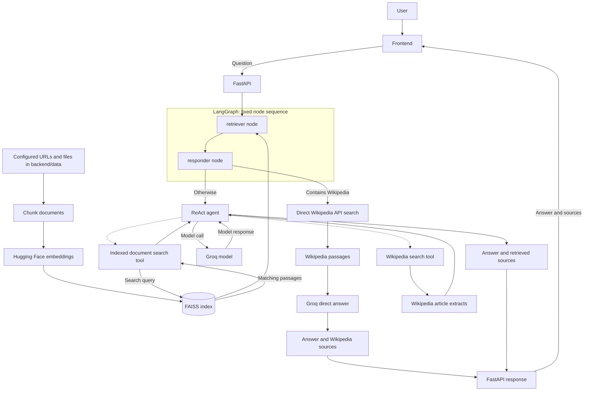

<div align="center">

<p></p>

<p><strong>Search your documents. Get answers with sources.</strong></p>

<p>


</p>
<p>


</p>

</div>

<p align="center">
ContextIQ.ai searches your documents, uses a ReAct agent to gather context, and returns answers with source passages.
The frontend is a lightweight Vite + TypeScript application; the backend is a FastAPI service powered by LangGraph, FAISS, Groq, and Wikipedia.
</p>

## Features

- Vanilla TypeScript frontend with a responsive search experience.
- FastAPI JSON API for health checks and document search.
- Groq chat completions, configurable with `GROQ_MODEL`.
- Local `sentence-transformers/all-MiniLM-L6-v2` embeddings.
- FAISS retrieval over configured web pages and PDFs in `backend/data/`.
- ReAct agent tools for the indexed corpus and Wikipedia's HTTPS API.
- Source passages included in search responses.

## Requirements

- Python 3.13+
- Node.js 20.19+ or 22.12+
- [uv](https://docs.astral.sh/uv/) for Python dependency management
- A Groq API key
- Internet access for Groq, source pages, Wikipedia, and the initial model
  download

## Getting started

### 1. Clone the project

```powershell
git clone https://github.com/proindra/ContextIQ.ai.git
cd ContextIQ
```

### 2. Configure the backend

Create the backend's local environment file from the tracked example:

```powershell
Copy-Item backend\.env.example backend\.env
```

Edit `backend\.env` and add your Groq API key:

```env
GROQ_API_KEY=your_groq_api_key
GROQ_MODEL=qwen/qwen3.8-27b
USER_AGENT=ContextIQ.ai/1.0 (contact: you@example.com)
FRONTEND_ORIGINS=http://localhost:5173,http://127.0.0.1:5173
```

`GROQ_API_KEY` is required. `GROQ_MODEL` is optional and defaults to
`qwen/qwen3.8-27b`; choose a model ID currently available to your Groq account.
`USER_AGENT` identifies requests made to source websites. The app supplies
`ContextIQ.ai/1.0` if it is omitted. `FRONTEND_ORIGINS` is an optional,
comma-separated list of browser origins allowed to call the API directly; the
Vite development proxy works with the defaults.

Keep `backend\.env` private. It is ignored by Git. Never paste a real key into
`.env.example`.

Install backend dependencies and test tools:

```powershell
Set-Location backend
uv sync --extra test
```

### 3. Start the API

In the `backend` directory:

```powershell
uv run uvicorn main:app --reload
```

The API runs at `http://127.0.0.1:8000`. Interactive API documentation is
available at `http://127.0.0.1:8000/docs`. On startup, the backend loads the
configured web pages and local PDFs, downloads the embedding model if needed,
and builds an in-memory FAISS index.

### 4. Start the frontend

Open a second terminal at the project root:

```powershell
Set-Location frontend
npm install
npm run dev
```

Open the Vite URL printed in the terminal (usually `http://127.0.0.1:5173`).
The Vite development server proxies `/api` requests to the FastAPI backend.
Keep both servers running while using the app.

### Publish the frontend to GitHub Pages

The GitHub Actions workflow deploys only `frontend/` when changes are pushed
to `main`. In the repository settings, set **Pages → Build and deployment →
Source** to **GitHub Actions**. You can also run the workflow manually from
the **Actions** tab.

To enable search on the published site, add a repository Actions variable named
`VITE_API_BASE_URL` containing the HTTPS origin of your deployed FastAPI API,
without a trailing slash (for example, `https://api.example.com`). Configure
the backend's `FRONTEND_ORIGINS` to allow the GitHub Pages site origin
(`https://proindra.github.io`). The API must be deployed separately; GitHub
Pages hosts only the static frontend. No API key or backend secret is included
in the frontend build.

## API

### `GET /api/health`

Returns `{"status":"ok"}` when the API is reachable.

### `POST /api/search`

Request:

```json
{
  "question": "What are the key components of an LLM-powered agent?"
}
```

Response:

```json
{
  "question": "What are the key components of an LLM-powered agent?",
  "answer": "The answer generated by the agent...",
  "sources": [
    {
      "title": "Agent guide",
      "source": "https://example.com/agents",
      "content": "A retrieved source passage..."
    }
  ],
  "elapsed_seconds": 1.23
}
```

Questions must contain non-whitespace text and be no longer than 2,000
characters. Provider or tool failures are logged by the API and return an
explicit `502` response.

## RAG architecture



At startup, the backend chunks configured sources, embeds them with
`sentence-transformers/all-MiniLM-L6-v2`, and builds an in-memory FAISS index.
For every question, LangGraph runs its `retriever` node and then its `responder`
node; it has no separate routing node. Inside the responder, a question
containing the word “Wikipedia” goes directly to Wikipedia search and a Groq
answer call. That path uses only Wikipedia sources, even though the initial
retrieval has already run. Other questions pass the initial retrieved passages
to the ReAct agent. The agent calls Groq and may use its indexed-document and
Wikipedia tools; the API returns the initial indexed passages plus any
additional passages returned by those tools.

## Project structure

```text
ContextIQ/
├── frontend/
│   ├── index.html
│   ├── package.json
│   ├── vite.config.ts
│   └── src/
│       ├── main.ts
│       ├── style.css
│       ├── animations/
│       ├── components/
│       ├── services/
│       └── types/
├── .github/
│   └── workflows/
│       └── deploy-frontend.yml
├── backend/
│   ├── main.py
│   ├── requirements.txt
│   ├── pyproject.toml
│   ├── api/
│   ├── src/
│   ├── data/
│   └── tests/
├── .gitignore
└── README.md
```

## Sources and configuration

Default web URLs are defined in `backend/src/config/config.py`. PDFs placed in
`backend/data/` are included when the API builds its index. The document
processor reads the data directory relative to the backend code, so startup
works regardless of the terminal's current directory.

Chunk size and overlap are configured in the same `Config` class. The embedding
model can be changed in `backend/src/vectorstore/vectorstore.py`.

## Tests and production build

Run the backend tests from `backend/`:

```powershell
uv run pytest
```

Build the static frontend bundle from `frontend/`:

```powershell
npm run build
```

## Troubleshooting

- **Missing Groq key:** verify `backend\.env` exists and has a non-empty
  `GROQ_API_KEY`.
- **Groq model 404:** set `GROQ_MODEL` in `backend\.env` to an active model
  available to your account, then restart the API.
- **Frontend cannot connect:** start the API on port `8000`; the Vite dev
  server forwards `/api` requests there.
- **Slow first API startup:** the embedding model is downloaded and run locally
  the first time.
- **Web or Wikipedia errors:** check internet access and retry. The API logs
  provider errors and returns a readable error response to the frontend.
